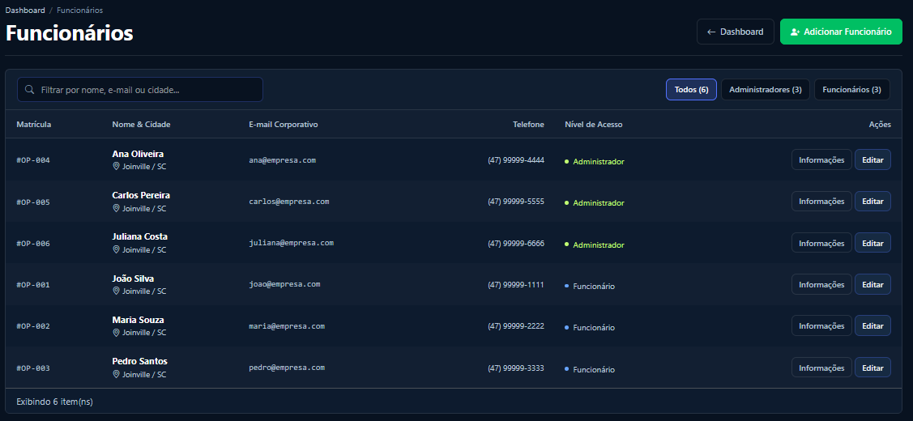
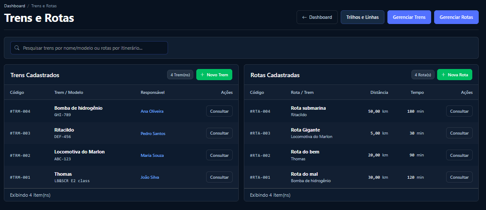

<div align="center">
  

  # TrackFlow — Ferrorama
  **Sistema Integrado de Telemetria, Gestão de Frota e Monitoramento Ferroviário (CCO)**  
  *"No ritmo que move estados."*

  
  
  
  
  -c1ff72?labelColor=081220)
</div>

---

## Sumário

1. [Nome do Projeto e Descrição da Ferrorama](#1-nome-do-projeto-e-descrição-da-ferrorama)
2. [Problema que o Sistema Busca Resolver](#2-problema-que-o-sistema-busca-resolver)
3. [Objetivos e Principais Funcionalidades](#3-objetivos-e-principais-funcionalidades)
4. [Tecnologias Utilizadas](#4-tecnologias-utilizadas)
5. [Requisitos Necessários para Executar o Sistema](#5-requisitos-necessários-para-executar-o-sistema)
6. [Instruções de Instalação e Configuração](#6-instruções-de-instalação-e-configuração)
7. [Instruções para Configurar e Importar o Banco de Dados](#7-instruções-para-configurar-e-importar-o-banco-de-dados)
8. [Orientações para Iniciar a Aplicação](#8-orientações-para-iniciar-a-aplicação)
9. [Perfis de Acesso e suas Permissões](#9-perfis-de-acesso-e-suas-permissões)
10. [Estrutura Geral do Projeto](#10-estrutura-geral-do-projeto)
11. [Integrantes e suas Contribuições](#11-integrantes-e-suas-contribuições)
12. [Imagens e Capturas de Tela da Versão Final](#12-imagens-e-capturas-de-tela-da-versão-final)
13. [Limitações Conhecidas](#13-limitações-conhecidas)

---

## 1. Nome do Projeto e Descrição da Ferrorama

- **Nome do Projeto:** **TrackFlow** (repositório `TrackFlow-SA` / `track-flow-sa`)
- **Identidade Operacional:** **TrackFlow · Ferrorama — Monitoramento Ferroviário**
- **Slogan:** *"No ritmo que move estados."*

### Sobre a Ferrorama
A **Ferrorama** é a empresa ferroviária atendida pelo sistema no contexto da Situação de Aprendizagem (SA). Ela opera composições expressas de alta velocidade (como o *Ferrorama Express*) e composições de transporte de carga (*Composição de Carga TrackFlow*) ao longo de corredores ferroviários compostos por viadutos, pontes, túneis, pátios de manobras e aparelhos de mudança de via (AMVs).

O **TrackFlow** foi projetado como a plataforma interna de **Centro de Controle Operacional (CCO)** da Ferrorama, unificando em uma interface web de alta densidade informacional o monitoramento de sensores ferroviários (embarcados nos trens e instalados na via permanente), o cadastro de trens, rotas e segmentos de trilho, a emissão/consulta de relatórios operacionais e a gestão de credenciais da equipe técnica.

---

## 2. Problema que o Sistema Busca Resolver

A operação de uma malha ferroviária envolve ativos críticos que operam sob severo estresse mecânico, térmico e climático. Quando o acompanhamento operacional depende de registros descentralizados, planilhas isoladas ou comunicação não padronizada entre equipes de campo e o Centro de Controle Operacional (CCO), surgem gargalos graves:

1. **Detecção tardia de falhas térmicas e mecânicas:** A falta de visibilidade imediata sobre o superaquecimento de rolamentos, mancais e discos de freio (*hotbox*, temperaturas $\ge 85\text{ °C}$) ou sobre vibrações excessivas na via permanente aumenta o risco de avarias e descarrilamentos.
2. **Descontrole sobre composições, rotas e responsáveis:** Dificuldade em rastrear qual operador é responsável por cada composição, quais sensores estão atrelados a cada trem ou segmento de trilho e qual a velocidade média planejada para cada rota.
3. **Impacto de condições meteorológicas severas:** Ausência de dados meteorológicos integrados ao painel de operação para alertar a equipe sobre tempestades, baixa visibilidade ou variações bruscas de temperatura na região da malha.
4. **Falta de governança e controle de acesso:** Necessidade de restringir operações críticas de cadastro, alteração e exclusão de ativos apenas a administradores autorizados, mantendo a consulta operacional acessível aos funcionários de turno.

---

## 3. Objetivos e Principais Funcionalidades

### Objetivo Geral
Disponibilizar um sistema web centralizado, seguro e responsivo que permita à **Ferrorama** registrar, monitorar e relatar a condição operacional de seus trens, rotas, segmentos de trilho e sensores em tempo real, garantindo rastreabilidade e controle de acesso por nível de permissão.

### Principais Funcionalidades

#### 1. Landing Page Interativa com Cena 3D WebGL (`index.php`)
- **Corredor Ferroviário 3D (`Three.js`):** Renderização em tempo real de um viaduto ferroviário duplo com catenária, balizas IoT pulsantes e duas composições animadas em sentidos opostos (*Ferrorama Express* e *Composição de Carga TrackFlow*).
- **Simulador de Telemetria da Linha:** Permite testar três cenários operacionais interativos (*Operação Normal*, *Aquecimento / Hotbox* e *Alerta na Via / Vibração*), atualizando dinamicamente leituras de temperatura (`°C`), vibração (`mm/s`), velocidade média (`km/h`) e recomendações técnicas.
- **Vitrine por Abas e Inspetor de Sensores:** Apresentação interativa dos módulos de *Sensores em Tempo Real*, *Trens e Linhas*, *Relatórios e Gráficos* e *Equipe e Acessos*.


#### 2. Autenticação e Segurança Operacional (`public/Login.php`, `public/logout.php`, `public/components/`)
- **Login Seguro:** Autenticação via e-mail corporativo e senha verificada com hash criptográfico (`password_hash` / `password_verify` no padrão `PASSWORD_DEFAULT`) e regeneração de ID de sessão (`session_regenerate_id(true)`).
- **Validação Contínua de Sessão (`start.php`):** A cada página acessada, o sistema revalida o usuário diretamente no banco de dados e sincroniza seu cargo, nome e foto de perfil.
- **Proteção Anti-CSRF (`csrf.php` e `erro_csrf.php`):** Todos os formulários `POST` utilizam tokens criptográficos de 32 bytes (`random_bytes(32)`) validados com comparação segura em tempo constante (`hash_equals()`), exibindo uma tela dedicada de bloqueio (`HTTP 403`) em caso de requisição inválida.

#### 3. Dashboard / Hub do Centro de Controle Operacional (`public/Hub.php`)

- **Identificação de Turno:** Exibe operador logado, crachá de nível de acesso (*Administrador* ou *Operador Ferroviário*), localização base (`Cidade / UF`) e horário atualizado no fuso `America/Sao_Paulo`.
- **Estação Meteorológica Integrada (`Open-Meteo API`):** Consulta a previsão climática real das coordenadas geográficas do operador logado (com *fallback* automático para Joinville/SC), exibindo temperatura atual, sensação térmica, umidade relativa, condição sinótica WMO e **alerta automático de clima severo** em caso de tempestades.
- **Carrossel de Gráficos Operacionais (`scripts/script_charts_hub.js`):**
  1. *Velocidade por Composição vs. Limite Operacional ($80\text{ km/h}$)*.
  2. *Curva Semanal de Temperatura Média da Via vs. Limite Seguro ($85\text{ °C}$)*.
  3. *Distribuição de Condição dos Sensores (Normal, Atenção e Falha)*.
  - Conta com renderização híbrida adaptativa: desenha gráficos instantâneos em **SVG nativo** para carregamento imediato e realiza *upgrade* assíncrono para **Google Charts** em dispositivos de alto desempenho.
- **Monitoramento Simultâneo de Sensores:** Duas tabelas de alta densidade lado a lado (**Sensores Embarcados no Trem** e **Sensores Fixos na Via Permanente**), integrando sensores cadastrados no banco de dados e sinalizando anomalias críticas.

#### 4. Gestão de Funcionários e Credenciais (`public/Admin.php`, `cadastro_usuario.php`, `editar_usuario.php`, `excluir_usuario.php`, `Usuario_Info.php`, `latitude.php`)

- **Quadro de Funcionários:** Listagem com matrícula padronizada (`#OP-001`), busca instantânea por nome/e-mail/cidade, filtro por perfil (*Todos*, *Administradores*, *Funcionários*) e paginação client-side.
- **Autopreenchimento de Endereço via CEP (`ViaCEP API`):** Ao informar o CEP de 8 dígitos no cadastro ou edição, rua, bairro, cidade e UF são preenchidos automaticamente.
- **Geocodificação Automática (`latitude.php`):** Após o cadastro do funcionário, o sistema consulta a API **Open-Meteo Geocoding** para obter e salvar a latitude e a longitude da cidade informada.
- **Upload Seguro de Foto de Perfil:** Validação do tipo MIME real do arquivo via `finfo` e `getimagesize()` (aceitando apenas PNG e JPG até 5 MB).
- **Proteção de Integridade Referencial:** Impede a exclusão de um funcionário caso exista algum trem cadastrado sob sua responsabilidade.

#### 5. Gestão de Frota, Rotas e Via Permanente (`public/trens_trilhos.php`, `cadastro_trens.php`, `editar_trem.php`, `excluir_trem.php`, `cadastro_rotas.php`, `editar_rota.php`, `excluir_rota.php`, `cadastro_linhas.php`, `atualizar_trilho.php`)

- **Painel Integrado de Trens e Rotas (`trens_trilhos.php`):** Visualização simultânea de composições (`#TRM-001`) e rotas (`#RTA-001`), busca rápida e modal de **Ficha Técnica** detalhada.
- **CRUD de Trens:** Cadastro, edição e exclusão de composições ferroviárias com vínculo ao funcionário responsável e bloqueio de exclusão caso o trem possua rotas ou sensores vinculados.
- **CRUD de Rotas com Calculadora Operacional:** Cadastro, edição e exclusão de rotas vinculadas a um trem, com cálculo automático em tempo real da **velocidade média planejada ($\text{km/h}$)** a partir da distância ($\text{km}$) e do tempo previsto ($\text{min}$).
- **CRUD de Trilhos / Via Permanente (`cadastro_linhas.php`):** Cadastro, edição via modal e exclusão de segmentos de trilho (`#VIA-001`), classificando o tipo de estrutura (*Bitola Larga (1,60 m)*, *Bitola Métrica (1,00 m)*, *Bitola Padrão (1,435 m)*, *AMV*, *Ponte / Viaduto*, *Túnel*, *Pátio de Manobras*) e impedindo a exclusão de segmentos que possuam sensores instalados.

#### 6. Módulos de Sensores e Relatórios (`public/Sensor_Data.php`, `public/Relatories.php`) — *Em desenvolvimento*
- Os módulos dedicados ao gerenciamento de **Sensores** (`Sensor_Data.php`) e à emissão/consulta de **Relatórios** (`Relatories.php`) tiveram seus fluxos de CRUD removidos nesta entrega e exibem atualmente a tela de *"Página em desenvolvimento"*.
- O acompanhamento visual dos sensores embarcados e da via permanente permanece disponível diretamente no **Dashboard CCO (`public/hub.php`)**.

#### 7. Tema Claro/Escuro e Adaptação de Performance
- **Dark Mode / Light Mode:** Alternância de tema persistida via `localStorage` (`color-scheme`).
- **Modo de Desempenho Adaptativo (`data-perf`):** Detecta automaticamente CPUs/dispositivos modestos, conexões lentas (`2G`/`3G`/`Save-Data`) ou preferência por redução de movimento para ajustar animações e gráficos sem perda de usabilidade.

---

## 4. Tecnologias Utilizadas

| Camada | Tecnologia / Biblioteca | Versão / Padrão | Finalidade no Projeto |
| :--- | :--- | :--- | :--- |
| **Back-end** | **PHP** | `8.0+` | Lógica de negócio, sessões, autenticação, validação CSRF, consumo de APIs e renderização SSR |
| **Banco de Dados** | **MySQL / MariaDB** (`mysqli`) | `utf8mb4` | Persistência relacional de funcionários, trens, rotas, trilhos, sensores e leituras |
| **Front-end (Marcação/Estilo)** | **HTML5 + CSS3 Customizado** | Design Tokens (`--ops-*`, `--ferro-*`) | Estrutura semântica, layout de alta densidade do CCO e suporte nativo a Dark/Light Mode |
| **Framework UI** | **Bootstrap + Bootstrap Icons** | `5.3.8` / `1.11.3` | Grid responsivo, menu lateral *Offcanvas*, modais, tabelas e iconografia técnica |
| **Front-end (Scripts)** | **JavaScript Vanilla** | `ES6+` | Filtros em tempo real, paginação automática, modais dinâmicos, cálculo de rotas e temas |
| **Gráficos 3D** | **Three.js (WebGL)** | Local (`scripts/three.min.js`) | Cena 3D interativa dos viadutos e composições ferroviárias na Landing Page |
| **Visualização de Dados** | **Google Charts + SVG Nativo** | `corechart` (`current`) | Gráficos operacionais do Hub CCO com fallback instantâneo em SVG |
| **Tipografia** | **Google Fonts + Fontes Locais** | `Inter`, `League Spartan`, `Space Grotesk`, `JetBrains Mono` | Hierarquia visual corporativa e exibição monoespaçada de telemetria |
| **API de Clima e Geocodificação** | **Open-Meteo API** | REST / JSON | Clima em tempo real no Hub (`v1/forecast`) e geocodificação de cidades (`v1/search`) |
| **API de Endereços** | **ViaCEP API** | REST / JSON | Preenchimento automático de rua, bairro, cidade e UF a partir do CEP |
| **Ambiente & Gestão** | **XAMPP, VS Code, Git/GitHub, Scrum & Kanban** | — | Servidor local Apache/MySQL, desenvolvimento, versionamento e gestão ágil das sprints |

---

## 5. Requisitos Necessários para Executar o Sistema

1. **Pacote de Servidor Web Local:**
   - **XAMPP** (recomendado), **WAMP**, **Laragon** ou ambiente equivalente contendo:
     - Servidor HTTP **Apache 2.4+**
     - **PHP 8.0 ou superior** (com as extensões `mysqli`, `fileinfo`, `gd`, `mbstring` e `openssl` habilitadas no `php.ini`)
     - **MySQL 5.7+ / 8.0+** ou **MariaDB 10.4+**
2. **Navegador Web Moderno:**
   - Google Chrome, Microsoft Edge, Mozilla Firefox ou Brave atualizados (com JavaScript e WebGL habilitados).
3. **Conexão com a Internet (Recomendada):**
   - Utilizada para carregar os pacotes via CDN (Bootstrap, Bootstrap Icons, Google Fonts, Google Charts) e consultar as APIs **ViaCEP** e **Open-Meteo**. O sistema possui *fallbacks* locais caso opere sem internet.

---

## 6. Instruções de Instalação e Configuração

1. **Obtenha o código-fonte do projeto:**
   Clone o repositório diretamente dentro do diretório `htdocs` do seu XAMPP:
   ```bash
   cd C:\xampp\htdocs
   git clone https://github.com/DanielTonioti/track-flow-sa.git
   ```
   *(Caso tenha baixado o arquivo `.zip`, extraia-o para que a raiz do projeto fique em `C:\xampp\htdocs\track-flow-sa`).*

2. **Verifique o arquivo de conexão com o banco de dados (`infra/conn.php`):**
   Por padrão, o arquivo já vem configurado para a instalação padrão do XAMPP:
   ```php
   $host = "localhost";
   $user = "root";
   $password = "";
   $database = "track_flow_m1";
   ```
   > Caso o seu servidor MySQL utilize senha para o usuário `root` ou porta customizada, ajuste as variáveis em `infra/conn.php`.

3. **Diretório de Uploads de Avatares:**
   Certifique-se de que a pasta `Assets/images/uploads/` existe ou que o PHP possui permissão de escrita para criá-la automaticamente durante o upload de fotos de perfil.

---

## 7. Instruções para Configurar e Importar o Banco de Dados

O sistema utiliza o banco de dados MySQL chamado **`track_flow_m1`**. Para criá-lo e importar todas as tabelas e dados iniciais de teste:

### Passo a Passo via phpMyAdmin
1. Abra o painel do **XAMPP** e inicie os módulos **Apache** e **MySQL**.
2. Acesse `http://localhost/phpmyadmin` no navegador.
3. Clique na aba **SQL** no topo da página, cole o script abaixo e clique em **Executar**:

```sql
CREATE DATABASE IF NOT EXISTS track_flow_m1
  CHARACTER SET utf8mb4
  COLLATE utf8mb4_unicode_ci;

USE track_flow_m1;

-- 1. Tabela de Funcionários e Administradores
CREATE TABLE IF NOT EXISTS funcionario (
    id INT AUTO_INCREMENT PRIMARY KEY,
    nome VARCHAR(100) NOT NULL,
    cep CHAR(8) NOT NULL,
    cidade VARCHAR(100) NOT NULL,
    rua VARCHAR(150) NOT NULL,
    bairro VARCHAR(100) NOT NULL,
    uf CHAR(2) NOT NULL,
    latitude DECIMAL(10, 6) DEFAULT NULL,
    longitude DECIMAL(10, 6) DEFAULT NULL,
    email VARCHAR(100) NOT NULL UNIQUE,
    senha VARCHAR(255) NOT NULL,
    telefone VARCHAR(20) NOT NULL,
    cargo ENUM('funcionario', 'admin') NOT NULL DEFAULT 'funcionario',
    avatar VARCHAR(255) DEFAULT NULL,
    criado_em TIMESTAMP DEFAULT CURRENT_TIMESTAMP
) ENGINE=InnoDB DEFAULT CHARSET=utf8mb4 COLLATE=utf8mb4_unicode_ci;

-- 2. Tabela de Trens (Composições Ferroviárias)
CREATE TABLE IF NOT EXISTS trem (
    id INT AUTO_INCREMENT PRIMARY KEY,
    nome VARCHAR(100) NOT NULL,
    modelo VARCHAR(50) NOT NULL,
    responsavel_usuario_id INT DEFAULT NULL,
    criado_em TIMESTAMP DEFAULT CURRENT_TIMESTAMP,
    CONSTRAINT fk_trem_responsavel FOREIGN KEY (responsavel_usuario_id)
        REFERENCES funcionario(id) ON DELETE RESTRICT ON UPDATE CASCADE
) ENGINE=InnoDB DEFAULT CHARSET=utf8mb4 COLLATE=utf8mb4_unicode_ci;

-- 3. Tabela de Rotas Ferroviárias
CREATE TABLE IF NOT EXISTS rota (
    id INT AUTO_INCREMENT PRIMARY KEY,
    nome VARCHAR(100) NOT NULL,
    descricao VARCHAR(500) NOT NULL,
    distancia_km DECIMAL(10, 2) NOT NULL,
    tempo_previsto_min INT NOT NULL,
    trem_id INT NOT NULL,
    criado_em TIMESTAMP DEFAULT CURRENT_TIMESTAMP,
    CONSTRAINT fk_rota_trem FOREIGN KEY (trem_id)
        REFERENCES trem(id) ON DELETE RESTRICT ON UPDATE CASCADE
) ENGINE=InnoDB DEFAULT CHARSET=utf8mb4 COLLATE=utf8mb4_unicode_ci;

-- 4. Tabela de Trilhos (Segmentos da Via Permanente)
CREATE TABLE IF NOT EXISTS trilho (
    id INT AUTO_INCREMENT PRIMARY KEY,
    nome VARCHAR(100) NOT NULL,
    localizacao VARCHAR(150) NOT NULL,
    tipo VARCHAR(50) NOT NULL DEFAULT 'Bitola Larga',
    criado_em TIMESTAMP DEFAULT CURRENT_TIMESTAMP
) ENGINE=InnoDB DEFAULT CHARSET=utf8mb4 COLLATE=utf8mb4_unicode_ci;

-- 5. Tabela de Sensores da Malha
CREATE TABLE IF NOT EXISTS sensor (
    id INT AUTO_INCREMENT PRIMARY KEY,
    nome VARCHAR(100) NOT NULL,
    tipo VARCHAR(50) NOT NULL,
    trem_id INT DEFAULT NULL,
    trilho_id INT DEFAULT NULL,
    CONSTRAINT fk_sensor_trem FOREIGN KEY (trem_id)
        REFERENCES trem(id) ON DELETE RESTRICT ON UPDATE CASCADE,
    CONSTRAINT fk_sensor_trilho FOREIGN KEY (trilho_id)
        REFERENCES trilho(id) ON DELETE RESTRICT ON UPDATE CASCADE
) ENGINE=InnoDB DEFAULT CHARSET=utf8mb4 COLLATE=utf8mb4_unicode_ci;

-- 6. Tabela de Leituras dos Sensores (Relatórios)
CREATE TABLE IF NOT EXISTS dados_sensor (
    id INT AUTO_INCREMENT PRIMARY KEY,
    sensor_id INT NOT NULL,
    valor DECIMAL(10, 2) NOT NULL,
    data_registro DATETIME NOT NULL DEFAULT CURRENT_TIMESTAMP,
    CONSTRAINT fk_dados_sensor FOREIGN KEY (sensor_id)
        REFERENCES sensor(id) ON DELETE RESTRICT ON UPDATE CASCADE
) ENGINE=InnoDB DEFAULT CHARSET=utf8mb4 COLLATE=utf8mb4_unicode_ci;

-- ============================================================================
-- DADOS INICIAIS PARA TESTE (SEED)
-- Senha padrão das duas contas abaixo: 123456
-- ============================================================================
INSERT INTO funcionario (nome, cep, cidade, rua, bairro, uf, latitude, longitude, email, senha, telefone, cargo)
VALUES
('Administrador Ferrorama', '89201400', 'Joinville', 'Rua Arno Waldemar Dohler', 'Zona Industrial Norte', 'SC', -26.304500, -48.848700, 'admin@trackflow.com', '$2y$10$92IXUNpkjO0rOQ5byMi.Ye4oKoEa3Ro9llC/.og/at2.uheWG/igi', '47999990001', 'admin'),
('Operador Ferroviario', '89201400', 'Joinville', 'Rua Arno Waldemar Dohler', 'Zona Industrial Norte', 'SC', -26.304500, -48.848700, 'operador@trackflow.com', '$2y$10$92IXUNpkjO0rOQ5byMi.Ye4oKoEa3Ro9llC/.og/at2.uheWG/igi', '47999990002', 'funcionario');
```
> **Observação sobre a senha do Seed SQL:** O hash bcrypt acima na carga de teste corresponde à senha **`password`**. Uma vez autenticado como Administrador (`admin@trackflow.com` / senha `password`), você pode cadastrar novos usuários ou alterar a senha diretamente pela interface em **Funcionários e Acessos → Editar**.

---

## 8. Orientações para Iniciar a Aplicação

1. Certifique-se de que os serviços **Apache** e **MySQL** estão com status **Running** (verde) no **XAMPP Control Panel**.
2. Abra o navegador e acesse a **Landing Page pública**:
   ```text
   http://localhost/track-flow-sa/
   ```
3. Para acessar diretamente a **Tela de Login do CCO**:
   ```text
   http://localhost/track-flow-sa/public/Login.php
   ```
4. Utilize uma das credenciais criadas no banco de dados (ou do seed acima):
   - **Perfil Administrador:** `admin@trackflow.com` | **Senha:** `password`
   - **Perfil Funcionário (Operador):** `operador@trackflow.com` | **Senha:** `password`
5. Após o login, você será redirecionado automaticamente ao **Dashboard do Centro de Controle Operacional (`public/hub.php`)**.

---

## 9. Perfis de Acesso e suas Permissões

O controle de autorização é gerenciado pela coluna `cargo` (`ENUM('funcionario', 'admin')`) na tabela `funcionario` e aplicado em todas as páginas por meio do guardião de sessão `public/components/start.php` (`redirecionarSeNaoAdmin()`):

| Módulo / Funcionalidade | Página / Endpoint | Funcionário (`funcionario`) | Administrador (`admin`) |
| :--- | :--- | :---: | :---: |
| **Landing Page 3D e Simulador** | `index.php` | ✅ Acesso público | ✅ Acesso público |
| **Autenticação (Login / Logout)** | `Login.php`, `logout.php` | ✅ Permitido | ✅ Permitido |
| **Dashboard CCO, Clima e Gráficos** | `public/Hub.php` | ✅ Visualização completa | ✅ Visualização + atalhos de gestão |
| **Meu Perfil (Dados do Próprio Operador)** | `public/Usuario_Info.php` | ✅ Apenas o próprio perfil | ✅ Qualquer operador (inclui telefone/CEP) |
| **Quadro de Funcionários** | `public/Admin.php` | 👁️ Consulta (sem telefone/ações) | ✅ Completo (vê telefone, edita e exclui) |
| **Cadastrar / Editar / Excluir Funcionário** | `cadastro_usuario.php`, `editar_usuario.php`, `excluir_usuario.php` | ❌ Bloqueado | ✅ Permitido |
| **Painel de Trens e Rotas (Ficha Técnica)** | `public/trens_trilhos.php` | 👁️ Consulta e Ficha Técnica | ✅ Completo + botões de cadastro/edição |
| **CRUD de Trens (Composições)** | `cadastro_trens.php`, `editar_trem.php`, `excluir_trem.php` | ❌ Bloqueado | ✅ Permitido |
| **CRUD de Rotas Ferroviárias** | `cadastro_rotas.php`, `editar_rota.php`, `excluir_rota.php` | ❌ Bloqueado | ✅ Permitido |
| **CRUD de Trilhos / Via Permanente** | `cadastro_linhas.php`, `atualizar_trilho.php` | ❌ Bloqueado | ✅ Permitido |
| **Módulo de Sensores (em desenvolvimento)** | `public/Sensor_Data.php` | 🚧 Em desenvolvimento | 🚧 Em desenvolvimento |
| **Módulo de Relatórios (em desenvolvimento)** | `public/Relatories.php` | 🚧 Em desenvolvimento | 🚧 Em desenvolvimento |

---

## 10. Estrutura Geral do Projeto

```text
track-flow-sa/
├── index.php                          # Landing Page pública com cena 3D WebGL (Three.js) e simulador de telemetria
├── README.md                          # Documentação completa do projeto
├── Assets/                            # Recursos estáticos e arquivos de mídia
│   ├── Font/                          # Fontes tipográficas locais (League Spartan)
│   ├── icons/
│   │   └── User.png                   # Avatar padrão para operadores sem foto cadastrada
│   ├── images/
│   │   └── uploads/                   # Diretório de armazenamento das fotos de perfil enviadas
│   └── logo/
│       ├── icone.ico                  # Favicon do sistema
│       └── logo-track-flow.png        # Logotipo oficial do TrackFlow
├── infra/
│   └── conn.php                       # Configuração de conexão MySQLi com o banco 'track_flow_m1' (utf8mb4)
├── public/                            # Páginas da aplicação autenticada e endpoints de processamento
│   ├── components/                    # Componentes modulares compartilhados
│   │   ├── csrf.php                   # Geração e validação criptográfica de tokens anti-CSRF
│   │   ├── erro_csrf.php              # Tela de bloqueio de segurança HTTP 403 (falha CSRF)
│   │   ├── head.php                   # Cabeçalho <head> padrão, Critical CSS e detector de performance
│   │   ├── navbar.php                 # Barra superior, menu do operador (tema/perfil/sair) e menu Offcanvas
│   │   └── start.php                  # Validação de sessão ativa e controle de acesso redirecionarSeNaoAdmin()
│   ├── Admin.php                      # Listagem, busca e filtro do quadro de funcionários e administradores
│   ├── atualizar_trilho.php           # Endpoint POST para atualização de segmentos de trilho
│   ├── cadastro_linhas.php            # Cadastro, listagem e exclusão de trilhos da via permanente
│   ├── cadastro_rotas.php             # Cadastro e listagem de rotas ferroviárias
│   ├── cadastro_trens.php             # Cadastro e listagem de composições ferroviárias (trens)
│   ├── cadastro_usuario.php           # Cadastro de funcionários com upload de avatar e integração ViaCEP
│   ├── editar_rota.php                # Edição de rotas ferroviárias
│   ├── editar_trem.php                # Edição de composições ferroviárias
│   ├── editar_usuario.php             # Edição de dados cadastrais, cargo, senha e foto de funcionário
│   ├── excluir_rota.php               # Endpoint POST para exclusão de rota
│   ├── excluir_sensor.php             # Endpoint POST para exclusão de sensor
│   ├── excluir_trem.php               # Endpoint POST para exclusão de trem (verifica vínculo com rotas/sensores)
│   ├── excluir_usuario.php            # Endpoint POST para exclusão de usuário (verifica vínculo com trens)
│   ├── Hub.php                        # Dashboard CCO com clima Open-Meteo, gráficos e tabelas de sensores
│   ├── latitude.php                   # Geocodificação automática via Open-Meteo após cadastro de funcionário
│   ├── Login.php                      # Tela de login de operadores e administradores
│   ├── logout.php                     # Encerramento seguro de sessão e limpeza de cookies
│   ├── Relatories.php                 # Tela do módulo de relatórios (em desenvolvimento)
│   ├── Sensor_Data.php                # Tela do módulo de sensores (em desenvolvimento)
│   ├── trens_trilhos.php              # Visão geral integrada de Trens e Rotas com modal de Ficha Técnica
│   └── Usuario_Info.php               # Ficha detalhada do funcionário / Meu Perfil e trens sob responsabilidade
├── scripts/                           # Módulos JavaScript do Front-end
│   ├── pagination.js                  # Paginação automática client-side para tabelas operacionais (.ops-table)
│   ├── script_auth.js                 # Botão de exibir/ocultar senha nos formulários de autenticação e cadastro
│   ├── script_cadastro_trens.js       # Controle do modal de confirmação de exclusão de trens
│   ├── script_cep.js                  # Consumo da API ViaCEP e preenchimento automático de endereço
│   ├── script_charts_hub.js           # Carrossel de gráficos do Hub CCO (SVG nativo + Google Charts adaptativo)
│   ├── script_editar_rota.js          # Cálculo dinâmico da velocidade média planejada na edição de rota
│   ├── script_linhas.js               # Controle dos modais de edição e exclusão de trilhos
│   ├── script_navbar.js               # Menu de perfil, alternância Dark/Light Mode e telemetria de performance
│   ├── script_trens_trilhos.js        # Busca unificada e modal de Ficha Técnica de trens e rotas
│   ├── scriptAdmin.js                 # Filtro por nível de acesso e busca instantânea na tabela de funcionários
│   ├── scriptClima.js                 # Atualização client-side do clima via Open-Meteo e decodificação WMO
│   ├── scriptIndex.js                 # Cena 3D WebGL (Three.js), simulador de telemetria e abas da Landing Page
│   ├── scriptRotas.js                 # Cálculo dinâmico de velocidade média e modal de exclusão de rotas
│   └── three.min.js                   # Biblioteca Three.js para renderização 3D WebGL
└── Styles/
    └── style.css                      # Folha de estilos global com Design Tokens TrackFlow (Dark & Light Mode)
```

---

## 11. Integrantes e suas Contribuições

O projeto foi desenvolvido utilizando as metodologias ágeis **Scrum** (com sprints organizadas por módulos e reuniões diárias de acompanhamento) e **Kanban** (com mais de 60 tarefas mapeadas e distribuídas entre a equipe):

| Integrante | Papel / Frentes de Contribuição |
| :--- | :--- |
| **Daniel Tonioti** | **Scrum Master & Desenvolvedor Full-Stack:** Coordenação das sprints e integração do repositório; arquitetura do Design System TrackFlow (`Styles/style.css` e Dark/Light Mode); reformulação do Dashboard Hub CCO (`Hub.php`) com integração da API Open-Meteo e gráficos híbridos; refatoração das páginas de trilhos, usuários, sensores e relatórios. |
| **Samuel Elias Candinho** | **Desenvolvedor Full-Stack:** Desenvolvimento de fluxos de autenticação, controle de sessão e permissões de acesso (`funcionario` vs `admin`), modelagem e integração de páginas operacionais com o banco MySQL. |
| **Roberto Stockhausen Hille** | **Desenvolvedor Full-Stack:** Implementação dos módulos de gerenciamento de ativos ferroviários (trens, rotas e linhas/trilhos), validações de formulário e regras de integridade referencial. |
| **Lucas Vieira Pedroso** | **Desenvolvedor Front-end & Back-end:** Desenvolvimento de interfaces de consulta, tabelas operacionais, filtros interativos em JavaScript, paginação e estruturação das telas de sensores e relatórios. |
| **Natan Vitor Dré Avanço Barbosa** | **Desenvolvedor Front-end** Participação no início do projeto. Foi mudado de equipe antes de começarmos a trabalhar no back-end.

---

## 12. Imagens e Capturas de Tela da Versão Final

### Identidade Visual Oficial
<div align="center">
  
  <p><em>Logotipo oficial do sistema TrackFlow — Ferrorama (<code>assets/logo/logo-track-flow.png</code>)</em></p>
</div>

### Telas da Versão Final do Sistema
As principais interfaces que compõem a versão final do **TrackFlow** são:

1. **Landing Page Institucional com Cena 3D (`index.php`):**
   - Corredor ferroviário 3D em WebGL (`Three.js`) com viadutos, balizas IoT e trens animados (*Ferrorama Express* e *Composição de Carga TrackFlow*), acompanhado do Simulador de Telemetria da Linha.
2. **Tela de Autenticação de Operador (`public/Login.php`):**
   - Interface de login em dois painéis com identidade visual do CCO, proteção CSRF e alternância de visualização de senha.
3. **Dashboard do Centro de Controle Operacional — Hub CCO (`public/Hub.php`):**
   - Painel com identificação do operador, Estação Meteorológica em tempo real (Open-Meteo), carrossel de 3 gráficos operacionais e tabelas simultâneas de sensores *No trem* e *Na via*.
4. **Gestão de Funcionários e Credenciais (`public/Admin.php` e `public/cadastro_usuario.php`):**
   - Listagem com busca instantânea, filtro por cargo, ficha detalhada (`Usuario_Info.php`) e formulário com autopreenchimento via ViaCEP e geocodificação automática.
5. **Gestão de Trens, Rotas e Via Permanente (`public/trens_trilhos.php`, `cadastro_trens.php`, `cadastro_rotas.php`, `cadastro_linhas.php`):**
   - Tabelas conjugadas de trens e rotas, modal de Ficha Técnica, calculadora automática de velocidade média planejada ($\text{km/h}$) e gestão de segmentos de trilho.

---

## 13. Limitações Conhecidas

1. **Módulos de Sensores e Relatórios em Desenvolvimento:**
   - Os arquivos de CRUD completo de sensores e relatórios foram removidos da entrega atual. As páginas `public/Sensor_Data.php` e `public/Relatories.php` permanecem acessíveis no menu apenas com o aviso *"Página em desenvolvimento"*.
2. **Dados Híbridos (Demonstrativos + Banco de Dados) no Hub CCO (`public/hub.php`):**
   - Para garantir que o Centro de Controle Operacional exiba telemetria ativa imediatamente após a instalação, o `hub.php` carrega um conjunto base de 10 sensores demonstrativos (`S.TRM.001` a `S.TRM.005` e `S.TRLH.001` a `S.TRLH.005`) e **mescla automaticamente** a essa listagem os sensores cadastrados na tabela `sensor`. Os gráficos do carrossel (`scripts/script_charts_hub.js`) utilizam séries operacionais demonstrativas.
3. **Recuperação de Senha Manual:**
   - Por se tratar de um sistema interno de operação ferroviária, não há redefinição autônoma de senha via disparo de e-mail SMTP; operadores que esquecerem sua credencial devem solicitar a redefinição a um usuário com perfil **Administrador** na tela de gestão de funcionários.
4. **Dependência de Internet para Recursos Externos (Com Fallbacks):**
   - A consulta ao ViaCEP e a atualização meteorológica da Open-Meteo requerem conexão ativa com a internet. Caso o servidor esteja *offline*, o endereço pode ser digitado manualmente e o widget climático utiliza automaticamente as coordenadas padrão de fallback (`Joinville / SC`), mantendo o sistema operacional.
