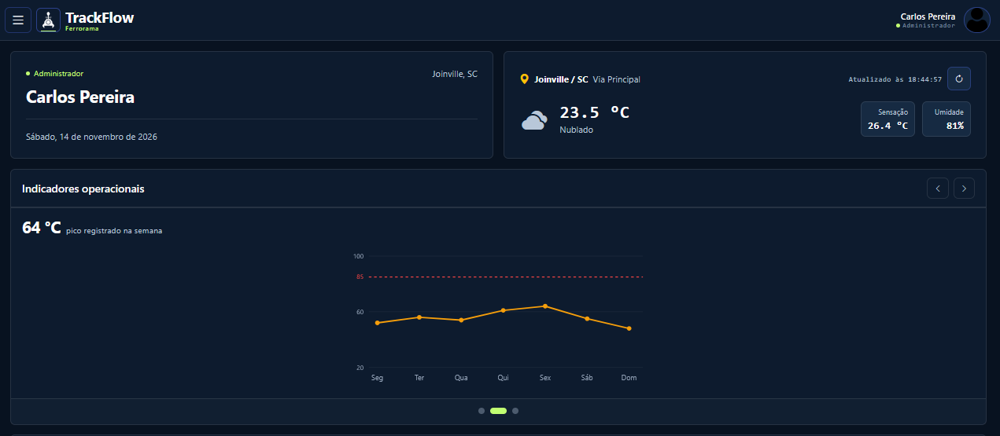

# TrackFlow-SA
---

## Nomes dos membros:
Samuel Elias Candinho, Roberto Stockhausen Hille, Lucas Vieira Pedroso , Daniel Tonioti e Natan Vitor Dré Avanço Barbosa

## Conceito:

O projeto consiste em fazer um aplicativo de um sistema interno de uma empresa ferroviária, com funções de geração de relatórios, gerenciamento de usuários, sensores, linhas e trens, além de um sistema de autenticação para permitir acesso apenas a pessoal autorizado. Usuários são separados entre Funcionários e Administradores, com o primeiro tendo apenas permissões de gerenciamento de relatórios, enquanto o último tem acesso total as funcioanlidades do site. 
O objetivo do projeto é criar um aplicativo que consiga, de maneira automática, registrar, monitorar e relatar a atual situação dos trens e trilhos com seus respectivos sensores, no final, tendo um sistema automatizado.

## Requisitos Funcionais Previstos:

### Login/Logout:
- Log-in;
- Log-out.

###  Gerenciamento de Sensores (Exclusivo de administradores):

- Cadastrar novo sensor, vinculado a um trem ou linha;
- Remover sensores.

### Gerenciamento de Funcionários (Exclusivo de administradores):

- Listagem de todos os usuários, com duas tabelas para administradores e funcionários;
- Função de Cadastrar usuários;
- Função de Remover usuários;
- Função de Permitir mudança de acesso de funcionários.

### Relatórios:

- Função de para gerar um novo relatório usando um trem ou linha com sensores cadastrados;
- Listagem de relatórios passados;
- Opção de visualizar detalhes de um relatório passado, mostrado gráficos de alterações ao longo do tempo especificado;
- Função de excluir um relatório passado.

### Gerenciamento de Trens (Exclusivo de administradores):

- Cadastrar trens;
- Remover trens.

### Gerenciamento de Linhas (Exclusivo de administradores):

- Cadastrar linhas;
- Remover linhas.

---
## Tecnologias Utilizadas:
- Front-end: HTML / CSS / JavaScript / PHP / SQL;
- Framework: Bootstrap;
- IDE: Visual Studio Code.

## Metodologias utilizadas:
Kanban: Com o objetivo de separar as diversas funções que cada um aplicara no projeto, o kanban foi utilizado para manter um senso de organização encima do que foi feito e o que está para ser feito. Foram definidas mais de 60 funções para serem divididas entre os quatro membros da equipe;
Sob sugestão do docente, o SCRUM será utilizado para manter a comunicação entre membros em relação ao progresso de cada dia. Estamos supostos a realizar uma reunião diária (Provavelmente próxima ao fim da aula) para conversar sobre o que cada um fez e quais são os próximos passos. Aparentemente o Daniel será o nosso SCRUM master. O projeto também possui diversos "seções" bem definidas, que facilitam a organização de sprints. Por exemplo, podemos pegar 1-2 semanas apenas para se focar no sistema de log-in e cadastro, aplicando as permissões relacionadas a funcionários e administradores.

## Formatação
Aparentemente, vamos usar formatações difentes para cada tipo de arquivo. Está planejadp que snake case seja usado nos arquivos PHP/HTML, enquanto camel case continuará nos arquivos javascript. Estamos incertos sobre a formatação usada nos assets. Nossa fonte League Spartan veio em Pascal case por padrão, por exemplo.

Estou reconsiderando o nosso uso atual de Javascript. O Javascript atual é usado para simular as funções que serão feitas pelo php, especialmente tudo envolvendo banco de dados, como o log-in, cadastro, exclusão, e geração de tabelas expondo dados cadastrados. Algumas funções no javascript ainda são utilizáveis, mas são em sua maioria efeitos visuais, como a navbar lateral colapsável. Mas ainda assim, a maioria do nosso javascript se tornará obsoleto.

## Tecnologias utilizadas
O plano original envolveria o uso de Internet das Coisas (IoT), mas devido ao tempo, acabamos com um site de CRUDs que utitliza SQL, PHP e servidores locais.

## Requisitos de execução
Da forma que ele está, para utilizar o sistema, tudo que é necessário é um navegador e um servidor local para executar o php.

## Execução
Para executar o sistema, recomendamos:
 - Instalar o XAMPP
 - Instalar o VSCode
 - Clonar o repositório do github no VSCode
 - Salvar a pasta clonada dentro de C:\xampp\htdocs com o nome "track-flow-sa";
 - Iniciar o servidor Apache e Mysql usando o XAMPP.
 - Entrar no seu navegador no endereço http://localhost:?/phpmyadmin, substituindo o "?" pelo port do apache no XAMPP. (Exemplo: 80, 8080, 9090)
 - Clique em "SQL" para abrir um editor de texto para a execução da linguagem SQL.
 - Cole o código dentro do arquivo db.sql no repositório, dentro da pasta "database"
 - Clique em executar ou aperte ctrl+enter. Isso vai criar o banco de dados necessário para o funcionamento do sistema.
 - Entrar no seu navegador no endereço http://localhost:?/track-flow-sa, substituindo o "?" pelo port do apache no XAMPP. (Exemplo: 80, 8080, 9090)

